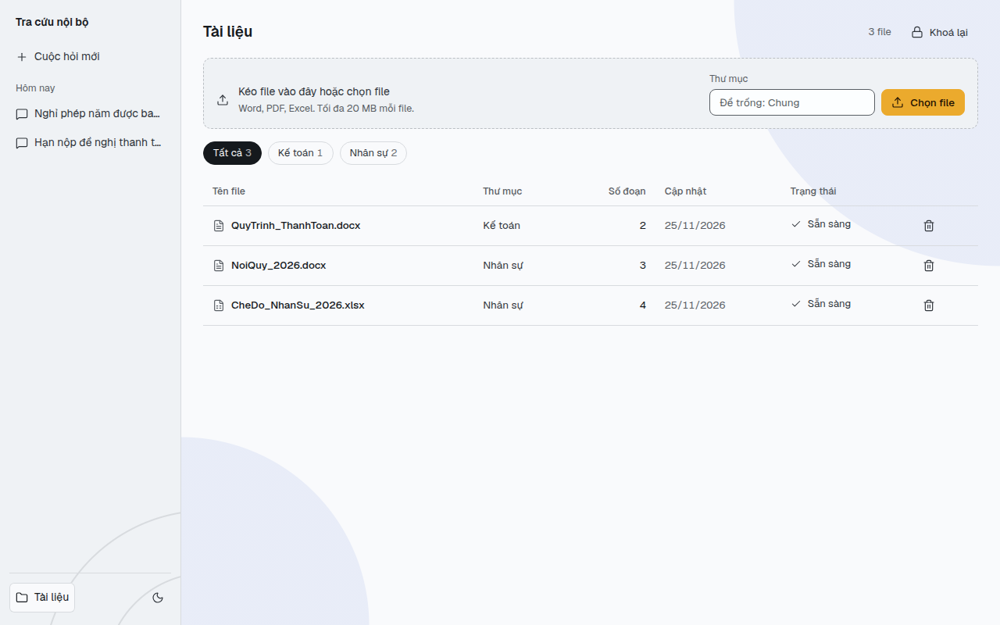
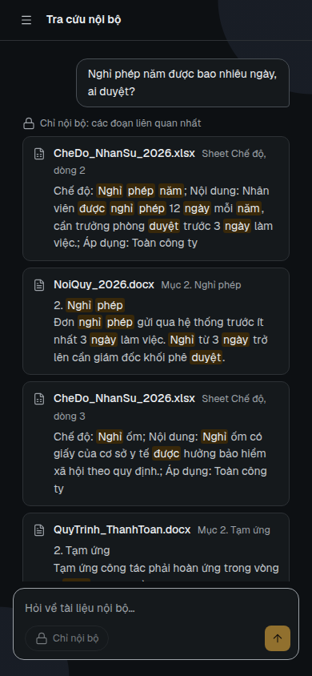
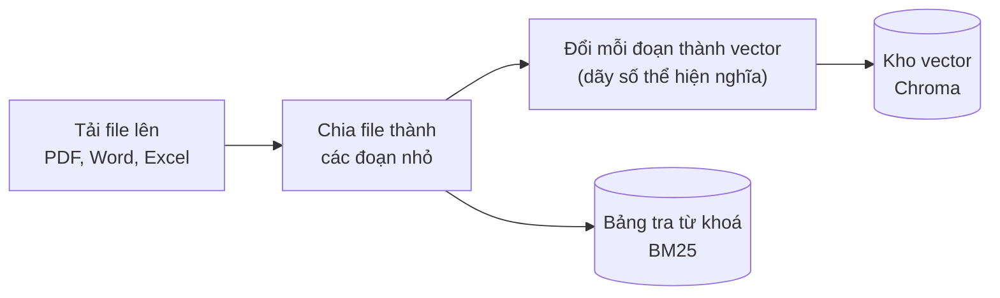
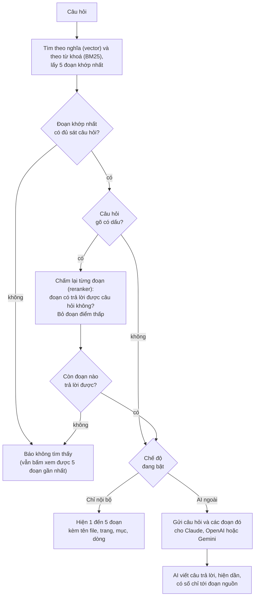

# ragdesk · Tra cứu nội bộ

Hỏi–đáp trên tài liệu nội bộ của team, chạy trong mạng nội bộ (LAN). Người quản trị tải lên file PDF, Word, Excel; mọi người gõ câu hỏi bằng tiếng Việt hoặc tiếng Anh và nhận lại những đoạn tài liệu trả lời câu hỏi, kèm vị trí trong file. Có thể bật thêm "AI ngoài" (Claude, OpenAI hoặc Gemini) để AI đọc các đoạn đó rồi viết thành câu trả lời, có ghi nguồn.


| Trang Tài liệu | Điện thoại |
|---|---|
|  |  |

*Ảnh chụp với tài liệu mẫu, nội dung giả.*

## Tính năng chính

- **Tải tài liệu lên** `.pdf`, `.docx`, `.xlsx` (tối đa 20 MB mỗi file), xếp theo thư mục. Tải lên file trùng tên thì file cũ được thay.
- **Tìm theo nghĩa và theo từ khoá**, chỉ giữ tối đa 5 đoạn thật sự trả lời câu hỏi, tô màu chữ khớp với câu hỏi, ghi rõ trang / mục / dòng Excel.
- **Chỉ nội bộ** (mặc định): không gọi AI nào, tài liệu không rời máy chủ.
- **AI ngoài** (khi quản trị cho phép): AI viết câu trả lời, hiện dần từng chữ, có số `[1]`, `[2]` chỉ tới đoạn nguồn.
- **Hỏi nối tiếp** không cần nhắc lại chủ đề: hỏi "nghỉ phép năm bao nhiêu ngày?" rồi hỏi tiếp "thế ai duyệt?".
- Giao diện sáng/tối, dùng được trên điện thoại, lịch sử hỏi lưu trên trình duyệt.

Chi tiết: [docs/tinh-nang.md](docs/tinh-nang.md).

## Luồng hoạt động

**Tải tài liệu lên** (máy chủ tự xử lý sau khi tải, người dùng không phải chờ):



- **Vì sao chia nhỏ:** khi hỏi, hệ thống trả về đúng đoạn chứa câu trả lời chứ không phải cả file.
- **Cách chia:** chữ trong PDF và Word cắt khoảng 800 ký tự một đoạn, hai đoạn liền nhau trùng một phần để không đứt câu. Bảng (Word và Excel) thì mỗi dòng là một đoạn, ghi kèm tên cột (ví dụ `Bậc: 3; Hệ số: 2,34`), để hỏi "hệ số lương bậc 3" ra đúng dòng đó.
- **Hai cách tìm:** vector giúp tìm theo nghĩa, hỏi bằng chữ khác với tài liệu vẫn ra; bảng tra từ khoá giúp tìm đúng chữ, số, mã hiệu.

**Hỏi** (mỗi câu hỏi):



- Mọi bước tìm và chấm điểm chạy ngay trên máy chủ, không cần card đồ hoạ (GPU). Chỉ nhánh **AI ngoài** gửi dữ liệu ra ngoài: câu hỏi và các đoạn đã chọn, không bao giờ gửi cả file.
- **Chấm lại từng đoạn** dùng model `bge-reranker-v2-m3`: đọc câu hỏi cùng từng đoạn và cho điểm đoạn đó có trả lời được câu hỏi không. Câu gõ không dấu bỏ qua bước này (model chấm sai câu không dấu) nên vẫn ra đủ 5 đoạn. Quản trị tắt được bước này bằng `RERANK_MODEL=off`.
- **Hỏi nối tiếp:** ở chế độ nội bộ, câu hỏi trước được ghép vào câu hiện tại khi tìm; ở chế độ AI ngoài, AI viết lại thành một câu đủ ý rồi mới tìm.
- Mức "đủ sát" và mức điểm để giữ đoạn chỉnh được bằng biến môi trường `MIN_RELEVANCE` và `RERANK_MIN`, xem [docs/van-hanh.md](docs/van-hanh.md).

## Cài đặt và chạy

Cần **Python 3.12** và **Node ≥ 20.19**. Lần chạy đầu cần internet để tải thư viện và hai model tìm kiếm (khoảng 1,1 GB). Không cần card đồ hoạ (GPU).

```bash
cd backend
python3 -m venv .venv
.venv/bin/pip install -r requirements.txt
```

```bash
cd frontend
npm ci
npm run build
```

Chạy (từ thư mục gốc của repo):

```bash
cd backend
DATA_DIR=../data \
ADMIN_PASSWORD=<mật khẩu không dấu> \
FASTEMBED_CACHE_PATH=../data/models \
ANONYMIZED_TELEMETRY=False \
  .venv/bin/uvicorn app:app --host 0.0.0.0 --port 8000
```

Mở `http://<địa chỉ máy chủ>:8000/`. Lần đầu khởi động chậm vì phải tải model.

**Bật AI ngoài:** thêm `ALLOW_EXTERNAL=true` cùng API key và tên model của ít nhất một nhà cung cấp, ví dụ `GEMINI_API_KEY=<key> GEMINI_MODEL=<tên model>`.

Mọi biến môi trường, dữ liệu, sao lưu: [docs/van-hanh.md](docs/van-hanh.md).

## Cách dùng

**Người hỏi**
1. Gõ câu hỏi, nhấn Enter.
2. Đọc các đoạn liên quan; mở file gốc nếu cần thêm.
3. Muốn câu trả lời viết sẵn thì bật **AI ngoài** trước khi gửi (công tắc tự tắt sau mỗi câu).

**Quản trị**
1. Vào **Tài liệu** → "Mở khoá quản trị" → nhập `ADMIN_PASSWORD`.
2. Nhập tên thư mục (để trống thì vào **Chung**), rồi chọn hoặc kéo thả file.
3. Chờ trạng thái chuyển sang "Sẵn sàng" là hỏi được.

## Cần biết trước khi dùng

- **Chưa có phân quyền:** ai vào được mạng nội bộ cũng đọc được mọi tài liệu qua câu hỏi. Chỉ nạp tài liệu cả team được xem.
- **AI ngoài gửi câu hỏi và các đoạn liên quan ra ngoài** cho nhà đang chọn. Lượt "Chỉ nội bộ" không bao giờ rời máy chủ.
- **Lịch sử hỏi nằm trong trình duyệt** và chứa nguyên văn đoạn tài liệu; máy dùng chung thì nên xoá dữ liệu trình duyệt sau khi dùng.
- **PDF chỉ có ảnh scan chưa đọc được** (chưa có nhận dạng chữ trong ảnh, OCR).
- **Sao lưu:** tắt máy chủ rồi chép cả thư mục `data/`.

Đầy đủ giới hạn và lưu ý riêng tư: [docs/tinh-nang.md](docs/tinh-nang.md#giới-hạn-hiện-tại).

## Tài liệu

| Tài liệu | Dành cho |
|---|---|
| [docs/tinh-nang.md](docs/tinh-nang.md) | Tính năng chi tiết, giới hạn, riêng tư |
| [docs/van-hanh.md](docs/van-hanh.md) | Biến môi trường, chạy máy chủ, dữ liệu, sao lưu, đo chất lượng tìm kiếm |
| [docs/phat-trien.md](docs/phat-trien.md) | Chạy khi phát triển, test, cấu trúc code, tài liệu thiết kế |
| [docs/lo-trinh.md](docs/lo-trinh.md) | Các đợt đã xong và các đợt tiếp theo |
