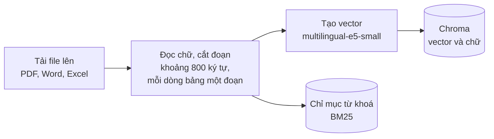
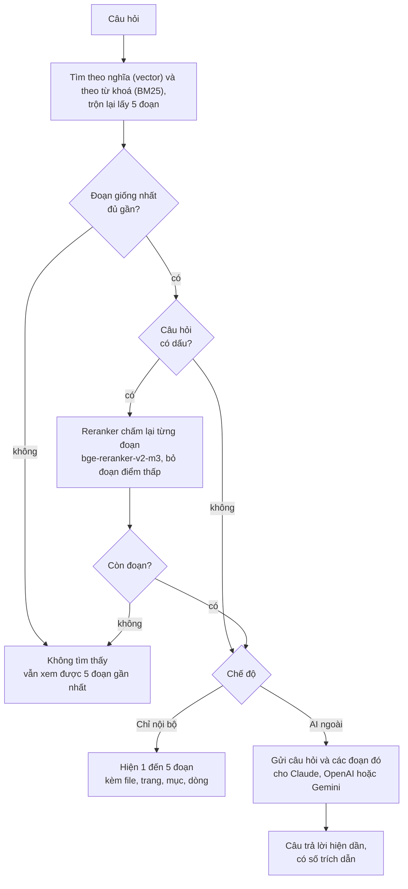

# ragdesk · Tra cứu nội bộ

Hỏi–đáp trên tài liệu nội bộ của team, chạy trong mạng LAN. Quản trị nạp file PDF, Word, Excel; mọi người gõ câu hỏi bằng tiếng Việt hoặc tiếng Anh và nhận lại các đoạn tài liệu liên quan nhất, kèm vị trí trong file. Có thể bật thêm "AI ngoài" (Claude, OpenAI hoặc Gemini) để có câu trả lời viết sẵn, kèm trích dẫn nguồn.


| Trang Tài liệu | Điện thoại |
|---|---|
|  |  |

*Ảnh chụp với tài liệu mẫu, nội dung giả.*

## Tính năng chính

- **Nạp tài liệu** `.pdf`, `.docx`, `.xlsx` (tối đa 20 MB mỗi file), xếp theo thư mục. Tải lên trùng tên là thay file.
- **Tìm theo nghĩa và theo từ khoá**, chấm lại từng đoạn rồi trả về tối đa 5 đoạn trả lời được câu hỏi, tô màu từ khớp, ghi rõ trang / mục / dòng Excel.
- **Chỉ nội bộ** (mặc định): không gọi AI nào, tài liệu không rời máy chủ.
- **AI ngoài** (khi quản trị cho phép): câu trả lời hiện dần, có số trích dẫn `[1]`.
- **Hỏi nối tiếp** trong cùng một cuộc hỏi, kiểu "thế ai duyệt?".
- Giao diện sáng/tối, dùng được trên điện thoại, lịch sử hỏi lưu trên trình duyệt.

Chi tiết: [docs/tinh-nang.md](docs/tinh-nang.md).

## Luồng hoạt động

**Nạp tài liệu** (quản trị tải file lên, máy chủ xử lý ở nền):



**Hỏi** (mỗi câu hỏi):



- Mọi bước tìm và chấm chạy trên máy chủ bằng CPU. Chỉ nhánh **AI ngoài** gửi dữ liệu ra ngoài: câu hỏi và các đoạn đã chọn, không bao giờ gửi cả file.
- Câu gõ không dấu bỏ qua reranker (model chấm sai câu không dấu), nên vẫn ra đủ 5 đoạn. Tắt hẳn reranker bằng `RERANK_MODEL=off`.
- Hỏi nối tiếp: chế độ nội bộ ghép câu trước vào khi tìm; AI ngoài nhờ AI viết lại thành câu đủ nghĩa rồi mới tìm.
- Hai ngưỡng (`MIN_RELEVANCE`, `RERANK_MIN`) chỉnh được bằng biến môi trường, xem [docs/van-hanh.md](docs/van-hanh.md).

## Cài đặt và chạy

Cần **Python 3.12** và **Node ≥ 20.19**. Lần chạy đầu cần internet để tải thư viện và model (khoảng 1,1 GB). Không cần GPU.

```bash
cd backend
python3 -m venv .venv
.venv/bin/pip install -r requirements.txt
```

```bash
cd frontend
npm ci
npm run build
```

Chạy (từ thư mục gốc của repo):

```bash
cd backend
DATA_DIR=../data \
ADMIN_PASSWORD=<mật khẩu không dấu> \
FASTEMBED_CACHE_PATH=../data/models \
ANONYMIZED_TELEMETRY=False \
  .venv/bin/uvicorn app:app --host 0.0.0.0 --port 8000
```

Mở `http://<địa chỉ máy chủ>:8000/`. Lần đầu khởi động chậm vì phải tải model.

**Bật AI ngoài:** thêm `ALLOW_EXTERNAL=true` và key + tên model của ít nhất một nhà, ví dụ `GEMINI_API_KEY=<key> GEMINI_MODEL=<tên model>`.

Mọi biến môi trường, dữ liệu, sao lưu: [docs/van-hanh.md](docs/van-hanh.md).

## Cách dùng

**Người hỏi**
1. Gõ câu hỏi, nhấn Enter.
2. Đọc các đoạn liên quan; mở file gốc nếu cần thêm.
3. Muốn câu trả lời viết sẵn thì bật **AI ngoài** trước khi gửi (công tắc tự tắt sau mỗi câu).

**Quản trị**
1. Vào **Tài liệu** → "Mở khoá quản trị" → nhập `ADMIN_PASSWORD`.
2. Nhập tên thư mục (để trống thì vào **Chung**), rồi chọn hoặc kéo thả file.
3. Chờ trạng thái chuyển sang "Sẵn sàng" là hỏi được.

## Cần biết trước khi dùng

- **Chưa có phân quyền:** ai vào được mạng nội bộ cũng đọc được mọi tài liệu qua câu hỏi. Chỉ nạp tài liệu cả team được xem.
- **AI ngoài gửi câu hỏi và các đoạn liên quan ra ngoài** cho nhà đang chọn. Lượt "Chỉ nội bộ" không bao giờ rời máy chủ.
- **Lịch sử hỏi nằm trong trình duyệt** và chứa nguyên văn đoạn tài liệu; máy dùng chung thì nên xoá dữ liệu trình duyệt sau khi dùng.
- **PDF chỉ có ảnh scan chưa đọc được** (chưa có OCR).
- **Sao lưu:** tắt máy chủ rồi chép cả thư mục `data/`.

Đầy đủ giới hạn và lưu ý riêng tư: [docs/tinh-nang.md](docs/tinh-nang.md#giới-hạn-hiện-tại).

## Tài liệu

| Tài liệu | Dành cho |
|---|---|
| [docs/tinh-nang.md](docs/tinh-nang.md) | Tính năng chi tiết, giới hạn, riêng tư |
| [docs/van-hanh.md](docs/van-hanh.md) | Biến môi trường, chạy máy chủ, dữ liệu, sao lưu, đo chất lượng tìm kiếm |
| [docs/phat-trien.md](docs/phat-trien.md) | Chạy dev, test, cấu trúc code, tài liệu thiết kế |
| [docs/lo-trinh.md](docs/lo-trinh.md) | Các đợt đã xong và các đợt tiếp theo |
