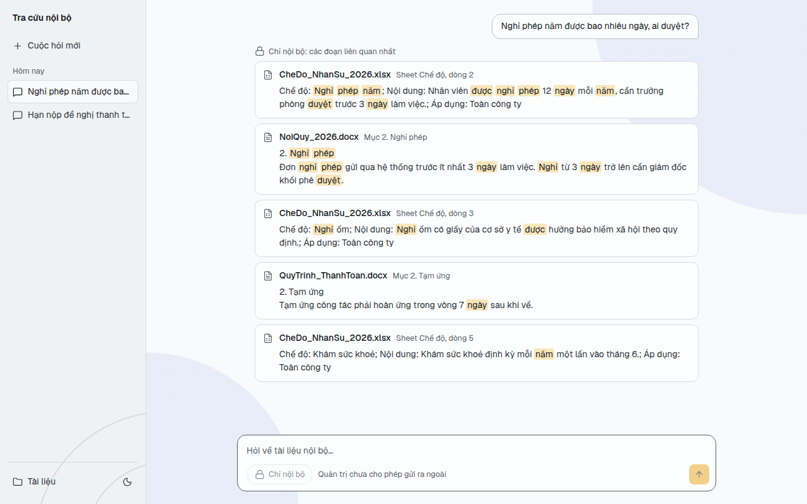
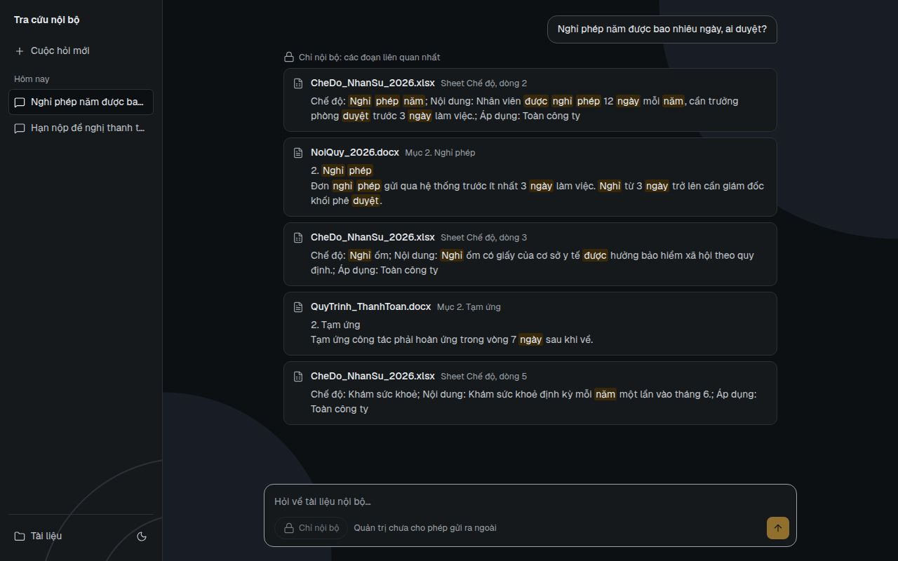
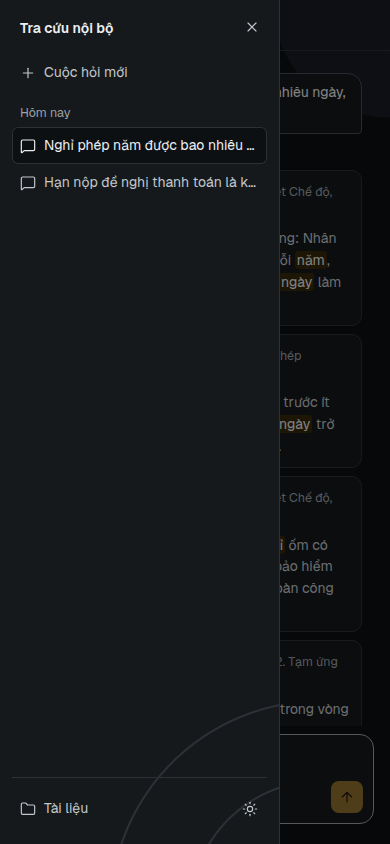

# Tra cứu nội bộ

Hệ thống hỏi–đáp trên tài liệu nội bộ (RAG) cho team, chạy trong mạng LAN. Quản trị nạp file PDF, Word, Excel. Mọi người gõ câu hỏi bằng tiếng Việt hoặc tiếng Anh và nhận lại các đoạn tài liệu liên quan nhất, kèm vị trí trong file. Quản trị có thể cho phép thêm chế độ "AI ngoài": Claude, OpenAI hoặc Gemini viết câu trả lời từ các đoạn đó, có trích dẫn nguồn.

Thiết kế chi tiết: `docs/2026-11-20-thiet-ke.md`. Lý do của từng quyết định: `docs/2026-11-20-ban-giao-brainstorm.md`.

## Ảnh chụp màn hình

Ảnh chụp từ bản chạy thật với ba tài liệu mẫu tự tạo (nội dung giả).



| Giao diện tối | Trang Tài liệu (đã mở khoá quản trị) |
|---|---|
|  |  |

| Điện thoại | Menu trên điện thoại |
|---|---|
|  |  |

## Làm được gì (đến đợt 2A)

**Nạp tài liệu** (trang Tài liệu, cần mật khẩu quản trị)
- Nhận `.pdf`, `.docx`, `.xlsx`, tối đa 20 MB mỗi file. Không nhận `.doc`, `.xls` đời cũ.
- Chọn hoặc kéo thả nhiều file một lần; file được gửi lần lượt. File sai đuôi hoặc quá cỡ bị báo riêng, các file còn lại vẫn gửi.
- Xếp tài liệu theo **một cấp thư mục**, có bộ lọc theo thư mục. Thư mục đang lọc nằm trên URL (`/tai-lieu?thu-muc=...`).
- Index chạy nền từng file một, có tiến độ `đoạn x/y`.
- **Tải lên trùng tên trong cùng thư mục là thay file.** Bản cũ vẫn tìm được cho tới khi bản mới index xong. Bản mới lỗi thì giữ nguyên bản cũ.
- Báo lỗi rõ từng file: PDF chỉ có ảnh scan, PDF có mật khẩu, file hỏng, file không có chữ.
- Xoá có xác nhận ngay trong dòng. File đang index thì chưa xoá được.
- Máy chủ tắt giữa lúc index: lần khởi động sau, file đó chuyển sang lỗi "Bị gián đoạn khi index, hãy tải lên lại". Không để lại đoạn rác.

**Cách đọc file**
- PDF: theo trang, giữ số trang.
- Word: theo đoạn văn, giữ tiêu đề mục gần nhất (Heading 1–3). Bảng trong Word đọc từng dòng.
- Excel: mỗi sheet lấy dòng đầu có dữ liệu làm tên cột. **Mỗi dòng sau đó thành một đoạn** dạng `Cột A: giá trị; Cột B: giá trị`, kèm tên sheet và số dòng. Lấy giá trị đã tính, không lấy công thức.
- PDF và Word được cắt thành đoạn khoảng 500 ký tự, chồng lấn khoảng 100.

**Tìm kiếm**
- Hybrid: tìm theo nghĩa bằng vector (`intfloat/multilingual-e5-small`, chạy CPU trên máy chủ) cộng tìm theo từ khoá (BM25). Hai kết quả được trộn bằng RRF, giữ **5 đoạn** tốt nhất.
- Mỗi đoạn hiện tên file, vị trí (trang / mục / sheet + dòng), và tô màu các từ khớp với câu hỏi.

**Hai chế độ trả lời** (công tắc cạnh ô hỏi)
- **Chỉ nội bộ** (mặc định): chỉ trả các đoạn tìm được. Không gọi AI nào, tài liệu không rời máy chủ.
- **AI ngoài** (Claude, OpenAI hoặc Gemini): chỉ bật được khi quản trị cho phép. Người dùng bật cho từng câu hỏi, gửi xong thì công tắc tự về tắt.
  - Quản trị khai key nhà nào thì nhà đó dùng được. Từ 2 nhà trở lên, cạnh công tắc có danh sách chọn nhà (Claude, OpenAI, Gemini); nhà đã chọn được nhớ trên trình duyệt. Nhãn của câu trả lời ghi rõ nhà, ví dụ "AI ngoài (Claude)".
  - Gửi đi cho nhà đang chọn: câu hỏi, 5 đoạn tìm được, system prompt, và **câu hỏi cùng câu trả lời của các lượt AI ngoài trước đó trong cùng cuộc hỏi, chỉ những lượt đã hỏi chính nhà này** (lấy trong 3 lượt gần nhất). Không bao giờ gửi cả file hay tên thư mục. Lượt "Chỉ nội bộ" và lượt của nhà khác không bao giờ được gửi: máy chủ tự lọc, không tin giao diện.
  - Câu trả lời hiện dần (stream), là văn bản thuần, có số trích dẫn `[1]`… và thẻ nguồn.
  - Gọi AI lỗi thì vẫn hiện 5 đoạn, kèm một dòng báo lỗi. Lỗi giữa chừng thì giữ phần chữ đã nhận.

**Hỏi nối tiếp** (trong cùng một cuộc hỏi)
- Hỏi tiếp kiểu "thế ai duyệt?" sau "Nghỉ phép năm bao nhiêu ngày?" vẫn ra đúng. Mỗi lần hỏi, trình duyệt gửi kèm tối đa 3 lượt gần nhất.
- **AI ngoài:** nếu có lượt AI ngoài trước đó của cùng nhà, máy chủ nhờ AI viết lại câu hỏi thành câu đủ nghĩa ("Nghỉ phép năm ai duyệt?") rồi mới tìm. Dòng nhỏ "Hiểu là: …" dưới câu hỏi cho thấy AI đã hiểu gì (chỉ hiện khi câu viết lại khác câu gốc). Bước viết lại lỗi thì dùng nguyên câu gốc. Câu trả lời cuối chỉ nhận câu đã viết lại và 5 đoạn, không nhận lại lịch sử.
- **Chỉ nội bộ:** không gọi AI. Khi tìm, câu hỏi ngay trước được ghép vào trước câu hiện tại. Từ khoá được tô màu chỉ tính theo câu hiện tại.
- Công tắc vẫn tự về "Chỉ nội bộ" sau mỗi câu hỏi. Hỏi nối tiếp bằng AI ngoài thì bật lại công tắc cho câu đó; quên bật thì câu hỏi chạy ở chế độ nội bộ.

**Giao diện**
- Thanh bên có "Cuộc hỏi mới", lịch sử hỏi chia theo ngày (Hôm nay / Hôm qua / Tuần trước / Cũ hơn), mục Tài liệu và nút đổi sáng/tối.
- Lịch sử lưu trên trình duyệt của từng người. Mỗi cuộc hỏi có link riêng `/c/<id>`, nhưng chỉ mở được trên đúng trình duyệt đã hỏi.
- Dùng được trên điện thoại: dưới 60rem, thanh bên thu vào nút Menu.

## Yêu cầu

- **Python 3.12.**
- **Node ≥ 22.12** để chạy test frontend. Chỉ build thì Node ≥ 20.19 là đủ.
- **Internet ở lần chạy đầu:** `pip`, `npm`, và tải model embedding khoảng 500 MB từ Hugging Face. Sau đó tìm kiếm chạy offline, trừ chế độ AI ngoài và font Google Fonts.
- Không cần GPU.

## Cài đặt

```bash
cd backend
python3 -m venv .venv
.venv/bin/pip install -r requirements.txt
```

```bash
cd frontend
npm ci
npm run build
```

`npm run build` tạo `frontend/dist`. Backend phục vụ luôn thư mục này, nên chỉ cần một cổng, không cần Nginx.

## Chạy

Từ thư mục gốc của repo:

```bash
cd backend
DATA_DIR=../data \
ADMIN_PASSWORD=<mật khẩu không dấu> \
FASTEMBED_CACHE_PATH=../data/models \
ANONYMIZED_TELEMETRY=False \
  .venv/bin/uvicorn app:app --host 0.0.0.0 --port 8000
```

Mở `http://<địa chỉ máy chủ>:8000/`.

- `--host 0.0.0.0` cho cả mạng LAN vào được. Chỉ thử trên máy mình thì dùng `--host 127.0.0.1`.
- **Lần đầu khởi động sẽ chậm** vì phải tải model embedding.
- **Nên đặt `FASTEMBED_CACHE_PATH`.** Không đặt thì model nằm trong `/tmp/fastembed_cache` và mất sau mỗi lần khởi động lại máy, nên lần chạy sau lại phải tải lại.
- **`DATA_DIR` tính theo thư mục đang đứng.** Chạy từ `backend/` thì phải để `../data`. Để mặc định `./data` thì dữ liệu sẽ nằm trong `backend/data`.

**Bật chế độ AI ngoài:** thêm `ALLOW_EXTERNAL=true` và khai key cùng tên model của ít nhất một nhà. **Tên model không có mặc định**, tự điền theo tên nhà đó đang cung cấp. Model suy luận của OpenAI (o-series, gpt-5…) dùng được.

```bash
ALLOW_EXTERNAL=true \
ANTHROPIC_API_KEY=<key> CLAUDE_MODEL=<tên model> \
OPENAI_API_KEY=<key> OPENAI_MODEL=<tên model> \
GEMINI_API_KEY=<key> GEMINI_MODEL=<tên model>
```

Khai một, hai hoặc cả ba nhà đều được. Thứ tự nhà luôn là Claude, OpenAI, Gemini; nhà đầu tiên đã khai là mặc định.

## Biến môi trường

| Biến | Bắt buộc | Mặc định | Ý nghĩa |
|---|---|---|---|
| `ADMIN_PASSWORD` | có | | Mật khẩu quản trị. Thiếu thì máy chủ không khởi động. **Chỉ dùng ký tự ASCII (không dấu)**: header HTTP không mang được chữ có dấu, và trang Tài liệu từ chối mật khẩu có dấu |
| `ALLOW_EXTERNAL` | | `false` | Công tắc tổng cho chế độ AI ngoài. Đặt `true` để bật (không phân biệt hoa thường) |
| `ANTHROPIC_API_KEY` + `CLAUDE_MODEL` | | | Khai đủ cả hai thì Claude dùng được (cần `ALLOW_EXTERNAL=true`). Tên model không có mặc định |
| `OPENAI_API_KEY` + `OPENAI_MODEL` | | | Như trên, cho OpenAI. Hỗ trợ cả model suy luận (o-series, gpt-5…) |
| `GEMINI_API_KEY` + `GEMINI_MODEL` | | | Như trên, cho Gemini |
| `DATA_DIR` | | `./data` | Nơi lưu file gốc, SQLite và index |
| `MAX_UPLOAD_MB` | | `20` | Cỡ tối đa mỗi file |
| `FASTEMBED_CACHE_PATH` | | `/tmp/fastembed_cache` | Nơi lưu model embedding. Nên đặt ra ngoài `/tmp` |
| `ANONYMIZED_TELEMETRY` | | | Đặt `False` để Chroma không gửi telemetry |

Chỉ khai key mà thiếu tên model (hoặc ngược lại) thì nhà đó coi như chưa khai. Không có nhà nào khai đủ thì công tắc AI ngoài bị khoá dù `ALLOW_EXTERNAL=true`.

## Sử dụng

**Người hỏi**
1. Mở trang chủ, gõ câu hỏi, nhấn Enter để gửi. Shift+Enter để xuống dòng. Bộ gõ tiếng Việt không bị gửi nhầm khi đang gõ dấu.
2. Kết quả là các đoạn liên quan nhất, kèm tên file và vị trí. Mở file gốc để đọc thêm.
3. Muốn có câu trả lời viết sẵn thì bật công tắc "AI ngoài" trước khi gửi (có từ 2 nhà thì chọn nhà ở danh sách bên cạnh). Công tắc bị khoá kèm dòng giải thích nghĩa là quản trị chưa cho phép.
4. Lịch sử hỏi nằm ở thanh bên trái. Hỏi tiếp trong cùng cuộc hỏi thì máy chủ hiểu theo các lượt trước (xem "Hỏi nối tiếp" ở trên). Với AI ngoài, câu trả lời hiện dần.

**Quản trị**
1. Vào **Tài liệu**, bấm "Mở khoá quản trị", nhập `ADMIN_PASSWORD`. Trạng thái mở khoá giữ đến khi đóng tab hoặc bấm "Khoá lại".
2. Nhập tên thư mục (gợi ý từ các thư mục đã có), rồi chọn hoặc kéo thả file. Để trống thì file vào thư mục **Chung**.
3. Chờ cột trạng thái chuyển từ "Đang index" sang "Sẵn sàng". Trang tự cập nhật mỗi 2 giây khi còn file đang index.
4. Muốn cập nhật một file thì tải lên bản mới **cùng tên, cùng thư mục**.
5. Xoá: bấm thùng rác ở dòng đó, rồi "Xoá file".

Ai cũng xem được danh sách tài liệu. Chỉ tải lên và xoá mới cần mật khẩu.

## Dữ liệu và sao lưu

Mọi thứ nằm trong `DATA_DIR`. Git bỏ qua thư mục này.

```
data/
  app.sqlite3          danh sách tài liệu, trạng thái
  chroma/              vector, chữ và metadata của các đoạn
  files/<thư mục>/     file gốc
  models/              model embedding (nếu đặt FASTEMBED_CACHE_PATH như trên)
```

**Sao lưu:** tắt máy chủ rồi chép cả `DATA_DIR`. Không chép lúc máy chủ đang chạy, vì dữ liệu có thể đang được ghi dở.

## Đo chất lượng tìm kiếm

Chuẩn bị khoảng 20 câu hỏi thật, mỗi câu ghi tên file chứa câu trả lời. Mẫu ở `backend/eval_questions.example.json`:

```json
[{"question": "Nghỉ phép năm được bao nhiêu ngày?", "filename": "Quy định nghỉ phép.pdf", "where": "trang 1"}]
```

**Tắt máy chủ trước**, vì hai tiến trình không dùng chung index Chroma được. Sau đó chạy:

```bash
cd backend
DATA_DIR=../data FASTEMBED_CACHE_PATH=../data/models ANONYMIZED_TELEMETRY=False \
  .venv/bin/python eval.py <file câu hỏi>.json
```

Kết quả là tỉ lệ câu có đúng file nằm trong top 5, kèm danh sách câu trượt. Đây là số liệu dùng để quyết định có cần thêm reranker hay tách từ tiếng Việt ở đợt sau không.

## Phát triển

**Giao diện:** chạy backend như mục Chạy, rồi:

```bash
cd frontend
npm run dev
```

Mở `http://localhost:5173`. Vite chuyển các request `/api` sang cổng 8000.

**Test và kiểm tra:**

```bash
cd backend && .venv/bin/pip install -r requirements-dev.txt
cd backend && ANONYMIZED_TELEMETRY=False .venv/bin/pytest
cd frontend && npm test
cd frontend && npm run lint
```

- Lint dùng `oxlint`.
- Test frontend chỉ giả lập `fetch`. Hợp đồng JSON giữa hai bên được kiểm ở test backend `tests/test_app.py`.

**Cấu trúc**

```
backend/
  app.py      FastAPI: route, mật khẩu quản trị, kiểm file tải lên, phục vụ frontend/dist
  ingest.py   đọc PDF / Word / Excel thành đoạn + metadata
  search.py   embedding, Chroma, BM25, RRF
  worker.py   luồng index nền (một file một lúc), thay file, khôi phục khi khởi động
  store.py    bảng documents (SQLite)
  llm.py      gọi Claude / OpenAI / Gemini qua client chuẩn OpenAI: stream câu trả lời, viết lại câu hỏi
  ask.py      luồng một lần hỏi: lọc lịch sử, viết lại câu, tìm, stream (sự kiện meta / delta / error / done)
  eval.py     đo chất lượng tìm kiếm
frontend/src/
  App.tsx, Sidebar.tsx, Chat.tsx, Answer.tsx, TaiLieu.tsx
  api.ts      gọi API + đọc SSE     history.ts  lịch sử + theme     format.ts  tô màu, trích dẫn
docs/         thiết kế, kế hoạch, bản phác giao diện
```

## Giới hạn hiện tại

- **Không phân quyền.** Ai vào được mạng nội bộ cũng đọc được nội dung mọi tài liệu qua câu hỏi. Chỉ nạp tài liệu cả team được xem.
- **Mật khẩu quản trị dùng chung** và đi qua HTTP thường trong LAN. Nên đặt sau HTTPS khi triển khai thật.
- **PDF scan (chỉ có ảnh) không đọc được**, file báo lỗi. Chưa có OCR.
- **Tìm từ khoá tách theo từng tiếng**, nên kém với từ ghép tiếng Việt. Phần tìm theo nghĩa bù lại phần lớn.
- **Không có ngưỡng "không liên quan":** đã có tài liệu thì luôn trả 5 đoạn, kể cả khi câu hỏi lạc đề.
- **Hỏi nối tiếp chỉ nhìn 3 lượt gần nhất,** mỗi câu hỏi tối đa 2.000 ký tự và mỗi câu trả lời tối đa 8.000 ký tự (dài hơn thì bị cắt khi gửi). Đổi nhà giữa cuộc hỏi thì nhà mới chỉ nhận câu hỏi hiện tại, vì không được xem lượt của nhà khác. Ở chế độ nội bộ, đổi chủ đề trong cùng cuộc hỏi có thể làm tìm lệch vì câu trước vẫn được ghép vào.
- **Chưa có nút "Dừng"** khi câu trả lời đang hiện dần. Mất kết nối giữa chừng thì lượt đó không được lưu, bấm "Thử lại".
- **Index chạy trên CPU,** file lớn sẽ chậm.
- **Cả ba nhà gọi qua cùng một client chuẩn OpenAI** (Claude và Gemini qua lớp tương thích của chính hãng). Lớp tương thích của Gemini đang beta, Google không cam kết giữ lâu dài.
- **Tên model do quản trị tự khai,** không chọn được trên giao diện.
- **Lịch sử chỉ nằm trên một trình duyệt,** không đồng bộ giữa các máy và chưa có nút xoá từng cuộc hỏi.

## Riêng tư

- **Lịch sử hỏi đáp nằm trong localStorage của trình duyệt** và chứa nguyên văn các đoạn tài liệu đã tìm được. Máy dùng chung thì nên xoá dữ liệu trình duyệt sau khi dùng.
- **Chế độ AI ngoài gửi nội dung ra bên ngoài.** Mỗi nhà chỉ nhận những gì đã được gửi cho chính nhà đó (câu hỏi, các đoạn liên quan, và các lượt AI ngoài trước đó của nhà đó). Nội dung lượt "Chỉ nội bộ" không bao giờ rời máy chủ.
- **Font Geist tải từ Google Fonts.** Mỗi lần mở trang, trình duyệt gửi request tới Google. Mạng LAN không ra internet thì giao diện dùng font hệ thống, vẫn đọc được. Google Fonts có subset tiếng Việt cho Geist và Geist Mono (đã kiểm ngày 25/11/2026).

## Các đợt tiếp theo

Danh sách dưới đây gom từ những mục thiết kế đã ghi "để đợt sau". **Chưa chốt thứ tự**: mỗi đợt sẽ brainstorm và duyệt thiết kế trước khi code, như đợt 1.

**Đã có hướng làm trong thiết kế**
- **Đăng nhập theo người và phân quyền theo thư mục.**
  - Thư mục đã được ghi vào metadata từng đoạn, nên lọc theo quyền không phải index lại.
  - Thay luôn mật khẩu quản trị dùng chung.
- **OCR cho PDF scan,** thay cho việc báo lỗi như hiện nay.

**Làm khi có số liệu hoặc phần cứng**
- **Reranker và tách từ ghép tiếng Việt** (ví dụ `underthesea`): chỉ làm khi `eval.py` với câu hỏi thật cho thấy tìm kiếm chưa đủ tốt.
- **Ngưỡng "không liên quan":** cũng cần số liệu từ `eval.py` để đặt.
- **LLM chạy ngay trên máy chủ:** cần máy có GPU. Khi đó chế độ nội bộ cũng có câu trả lời viết sẵn mà tài liệu không rời máy.

**Vận hành khi triển khai thật**
- HTTPS, chạy như dịch vụ hệ thống, sao lưu `DATA_DIR` định kỳ.
- Tự host font nếu máy người dùng không ra được internet.
